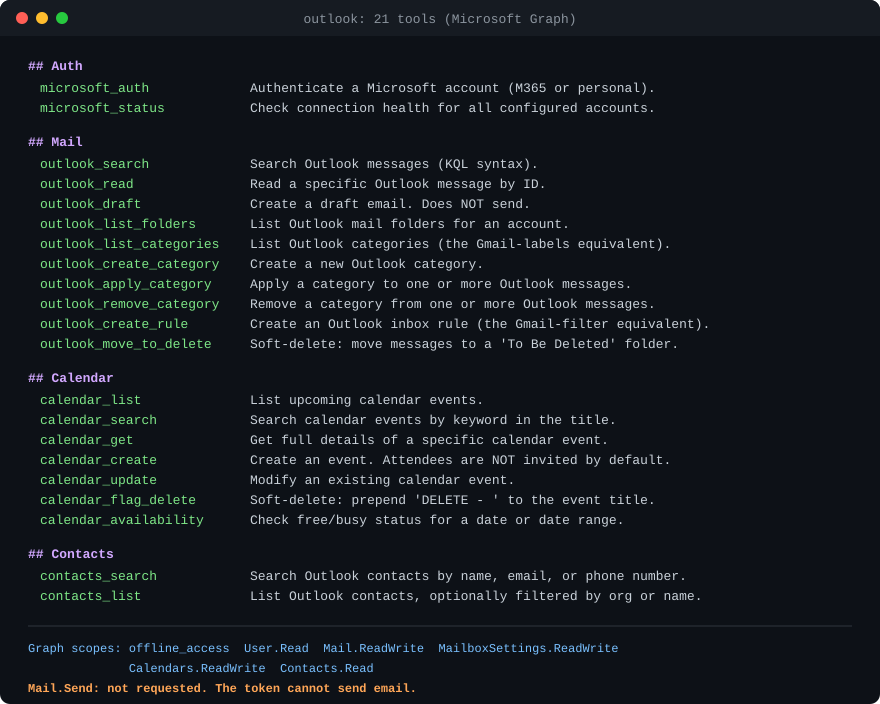

# mariana-outlook-mcp

Let Claude Code read, organize and draft in your Outlook mailbox, calendar and contacts. It can't send email: the Mail.Send permission is never requested. It doesn't delete: mail moves to a To Be Deleted folder and events get a DELETE prefix. Mail-rule forwarding and calendar invites are opt-in actions you ask for.

**Who this is for:** people who want AI help in Outlook (work M365 or personal Outlook/Hotmail) with safety-first defaults and a log of every change.

[](LICENSE)
[](https://claude.com/claude-code)
[](https://github.com/marianasmall/mariana-outlook-mcp/commits/main)



*The 21 tools Claude Code sees once the server is connected, plus the exact Microsoft Graph permissions it asks for.*

**Quick start** (you need an Azure Application ID first; see [Setup](#setup) step 1):

```bash
git clone https://github.com/marianasmall/mariana-outlook-mcp.git
cd mariana-outlook-mcp && npm install && npm run build
claude mcp add outlook --scope user -e MS_CLIENT_ID="<application-client-id>" -- node "$PWD/dist/index.js"
```

Then restart Claude Code and run the sign-in tool (Setup step 4).

## What This Is

A custom MCP (Model Context Protocol) server that connects Claude Code to Outlook Mail, Calendar, and Contacts through Microsoft Graph. Sibling of [mariana-google-mcp](https://github.com/marianasmall/mariana-google-mcp), same architecture pointed at Microsoft accounts (M365 work/school and personal Outlook/Hotmail).

## Design Philosophy

Built for an operator who wants AI help managing their mailbox without risk of accidental damage:

- **No sending email, enforced by Microsoft, not just this code.** The server never requests the `Mail.Send` permission, so its tokens cannot send a message. You draft; you send from Outlook. Two opt-in actions can still make mail go out, and only when you ask: an inbox rule with a forwarding address (`outlook_create_rule`), and a calendar event created with `send_invites=true`.
- **No deleting anything.** Mail moves to a "To Be Deleted" folder (reversible). Calendar events get "DELETE - " prepended to the title. You review and confirm in the Outlook UI.
- **Every mutation is logged.** An append-only JSONL action log records every write with timestamps, tool name, account, and summary.
- **Multi-account support.** Work and personal Microsoft accounts under named aliases.
- **No client secret.** Desktop PKCE flow: the only credential is a public Application ID.

## Setup

**Easiest path:** paste this one line into Claude Code and it runs the entire setup for you, including guiding you through the Azure clicks:

> Fetch https://raw.githubusercontent.com/marianasmall/mariana-outlook-mcp/main/SETUP-PROMPT.md and follow the instructions in it.

The manual steps below cover the same ground.

### 1. Azure App Registration

1. Go to [portal.azure.com](https://portal.azure.com) → search "App registrations" → **New registration**
2. Name: "Claude Code". Supported account types: **Accounts in any organizational directory and personal Microsoft accounts** (the option that includes personal accounts)
3. Redirect URI: platform **Public client/native (mobile & desktop)**, value `http://localhost`
4. Register, then copy the **Application (client) ID** from the Overview page
5. Under **Authentication**, set "Allow public client flows" to **Yes**

No client secret is created. This is a PKCE public client.

### 2. Install and Build

```bash
git clone https://github.com/marianasmall/mariana-outlook-mcp.git
cd mariana-outlook-mcp
npm install
npm run build
```

### 3. Add to Claude Code

```bash
claude mcp add outlook --scope user \
  -e MS_CLIENT_ID="<application-client-id>" \
  -- node /FULL/PATH/TO/mariana-outlook-mcp/dist/index.js
```

Optional: set `MS_TENANT` to a specific tenant ID (defaults to `common`, which accepts both work and personal accounts). Restart Claude Code after adding.

### 4. Authenticate

Run the `microsoft_auth` tool with a friendly account name (e.g. `consulting`, `personal`). A browser window opens for consent; approve as the matching Microsoft account. Repeat per account. Verify with `microsoft_status`.

## Available Tools (21)

### Authentication & Status
| Tool | Description |
|------|-------------|
| `microsoft_auth` | Authenticate a Microsoft account via OAuth browser flow (PKCE) |
| `microsoft_status` | Live connection health for all configured accounts |

### Mail (10 tools)
| Tool | Description |
|------|-------------|
| `outlook_search` | Search messages (KQL: from:, subject:, or keywords) |
| `outlook_read` | Read a specific message by ID (plain-text body + attachment names) |
| `outlook_draft` | Create a draft: plain text or rich HTML body, attachments (≤3MB/file), optional reply-in-thread (does NOT send) |
| `outlook_list_folders` | List mail folders with unread counts |
| `outlook_list_categories` | List categories (the Gmail-labels equivalent) |
| `outlook_create_category` | Create a category |
| `outlook_apply_category` | Apply a category to messages |
| `outlook_remove_category` | Remove a category from messages |
| `outlook_create_rule` | Create an inbox rule (the Gmail-filter equivalent) |
| `outlook_move_to_delete` | Soft-delete: move messages to a "To Be Deleted" folder |

### Calendar (7 tools)
| Tool | Description |
|------|-------------|
| `calendar_list` | List upcoming events |
| `calendar_search` | Search events by title keyword |
| `calendar_get` | Full details of one event |
| `calendar_create` | Create an event (attendees NOT invited by default) |
| `calendar_update` | Modify an event (attendee-notification caveat in tool description) |
| `calendar_flag_delete` | Soft-delete: prepend "DELETE - " to the title |
| `calendar_availability` | Free/busy blocks for a date range |

### Contacts (2 tools)
| Tool | Description |
|------|-------------|
| `contacts_search` | Search contacts by name, email, or phone |
| `contacts_list` | List contacts, optionally filtered |

## Multi-Account Support

```
microsoft_auth account_name: "consulting"
microsoft_auth account_name: "personal"
```

Most tools accept an optional `account` parameter; omitted, they use the default (first-connected) account. `microsoft_status` shows all accounts and their health.

## Configuration Files

All state lives in `~/.config/mariana-outlook-mcp/`:

| File | Purpose |
|------|---------|
| `config.json` | Account registry (aliases, email hashes, default) |
| `tokens/<hash>.json` | OAuth tokens per account (never leave this machine) |
| `action-log.jsonl` | Append-only log of every write operation |

## Graph-vs-Gmail Differences Worth Knowing

- **Categories ≈ labels; folders ≈ folders.** Outlook has both. Categories apply like Gmail labels; soft-delete uses a folder because that's the native Outlook idiom.
- **Reply drafts** take a `reply_to_message_id` (Graph threads replies from a message, not a thread ID).
- **Moved messages get new IDs.** Graph reassigns message IDs on folder moves.
- **Attendee invitations**: Outlook sends invitation/update emails itself when an event has attendees; `calendar_create` therefore defaults to NOT attaching attendees (names go in the description) unless `send_invites=true`.
- **Refresh tokens** last ~90 days sliding for personal accounts. Regular use keeps them alive indefinitely; a long-unused account may need re-auth.

## License

MIT
